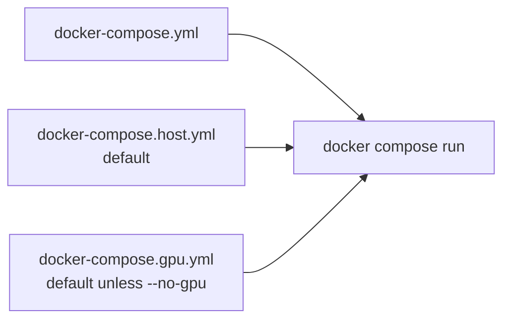

# Development Environment Conventions

This note records the containerization pattern used by the sibling projects in
`/home/gerardo/workspace`, and how it is expected to be adapted here.

**References**

- `../monaco_f1tenth/docker/` — full-featured variant (ROS 2 Jazzy, GPU, prebuilt workspace, hardware)
- `../svdsim/docker/` — minimal variant (same skeleton, no prebuilt workspace)

Both are structurally identical: same `run.sh`, same compose split, same `files/` helpers. The
MuJoCo environment is a copy of the **svdsim** shape, extended with graphics dependencies.

## As implemented in this repository

The container is in `docker/` and mirrors the reference layout, with these intentional differences:

- **No ROS layer.** Slim `ubuntu:noble` image; no colcon, rosdep, DDS configuration or
  `ROS_DOMAIN_ID` requirement. A ROS 2 stage can be added later without changing the user-facing
  workflow.
- **MuJoCo instead of a workspace build.** `mujoco==4.0.1` is installed from a pinned
  `docker/files/requirements.txt` into the system Python (3.12), following the reference projects'
  use of `PIP_BREAK_SYSTEM_PACKAGES=1`.
- **Optional GPU physics.** The same requirements include `mujoco-warp==4.0.1` for
  `scratchbook/03_py_marbles_box/main.py --warp`. Standard MuJoCo remains the default CPU
  backend. Warp mode needs an NVIDIA CUDA device exposed through the GPU Compose override.
  Rebuild the image after changing Python dependencies.
- **Entrypoint is `/mujoco_entrypoint.sh`**, not `/ros_entrypoint.sh`.
- **Persistence** keeps `cache` and `.bash_history` per uid; it does not create `build/` or
  `install/` trees.
- **Graphics libraries** (`libegl1`, `libosmesa6`, `libglfw3`, Mesa DRI, Vulkan, X11 libs) are part of
  the base image so both the viewer and offscreen rendering work.
- **C++ toolchain**: `build-essential`, `cmake`, `ninja-build`, `pkg-config`, `ccache`, plus the
  `-dev` GL/GLFW/GLEW headers needed to build windowed applications and samples.
- **MuJoCo C/C++ SDK**: the official `mujoco-<version>-linux-<arch>.tar.gz` release archive is
  downloaded at build time, checksum-verified and installed under `/usr/local` (headers, shared
  library, plugins and the `simulate` binary). The archive ships no CMake package config, so the
  image installs the minimal `docker/files/mujocoConfig.cmake` as
  `/usr/local/lib/cmake/mujoco/mujocoConfig.cmake`, which exposes the `mujoco::mujoco` imported
  target. `find_package(mujoco)` and `ldconfig` then work without extra environment variables. The
  version is pinned with `ARG MUJOCO_VERSION` and must match `docker/files/requirements.txt`.
- **MuJoCo source**: a shallow clone of the repository at the pinned version is kept at
  `/opt/mujoco-src` so the documentation (`doc/`, reStructuredText/Markdown source), sample code
  (`sample/`), models (`model/`) and headers are browsable offline. The `mjdoc` and `mjmodels`
  aliases jump there.

## Directory layout

```
docker/
├── Dockerfile                 # Multi-stage image definition
├── docker-compose.yml         # Base service definition
├── docker-compose.host.yml    # Override: host networking
├── docker-compose.gpu.yml     # Override: NVIDIA runtime
├── run.sh                     # Single entry point (build + run + stop)
└── files/
    ├── entrypoint.sh          # Persistence symlinks, version banner, readiness marker
    ├── fixuid_wrapper.sh      # Pre-fixuid banner
    ├── fixuid_config.yml      # Which paths to re-own
    ├── requirements.txt       # Pinned Python dependencies (MuJoCo)
    └── bash_aliases           # Project-specific shell aliases
```

The repository itself is bind-mounted into the container at
`/home/developer/ws/src/project` (compose `volumes: - ..:/home/developer/ws/src/project`).
Nothing is copied at run time; the image only contains system dependencies and prebuilt externals.

## Image structure

```
ubuntu:noble
└── <project>_service_image_base     # tooling, locale/timezone, sudo user (uid/gid 1000)
    ├── <project>_service_image_devel  # project toolchain, user, workspace, entrypoint
    └── <project>_service_image_*      # optional: prebuilt third-party caches
```

Conventions worth preserving:

- `ARG USER=developer`, `ARG GROUP=developer`; the user is created with uid/gid **1000** so host
  files are owned correctly before `fixuid` runs.
- A build stage caches only dependency manifests (`package.xml`) so `rosdep` can run before the
  full source is copied. Not needed for a pure-Python MuJoCo setup.
- Third-party sources are pinned in `files/source_dependencies.repos` and prebuilt into
  `~/prebuilt_ws` at image build time, so `docker compose build` stays slow-but-once and container
  startup is fast.
- `ENV WITHIN_DEV=1` is set in the image; `run.sh` refuses to run when it is already set.
- `ENV PIP_BREAK_SYSTEM_PACKAGES=1` — Ubuntu's PEP 668 guard is disabled deliberately.

## User identity: fixuid

The image user is fixed at build time, but the host uid/gid may differ. The image installs
[`fixuid`](https://github.com/boxboat/fixuid) on `/etc/fixuid/config.yml` with `paths: [/home]`, and
the container entrypoint is:

```dockerfile
ENTRYPOINT ["/fixuid_wrapper.sh", "fixuid", "-q", "/mujoco_entrypoint.sh"]
```

(The reference projects use `/ros_entrypoint.sh`.)

`run.sh` passes `USERID=$(id -u) GROUPID=$(id -g)` into compose, which sets `user:` on the service.
The entrypoint then touches `$HOME/.fixuid_complete` as the unprivileged user — it must be writable,
so it deliberately lives outside the bind-mounted tree — and `run.sh --daemon` polls that path
before reporting success.

Because of `paths: [/home]`, `fixuid` also re-owns the bind-mounted repository. That is a no-op when
`USERID` matches the owner of the host files (the normal case), but a mismatched `USERID` would
rewrite ownership of the host checkout.

## Persistence

A named volume is mounted at `~/ws/persistence`, and `entrypoint.sh` symlinks per-uid
subdirectories into the home directory and workspace:

| Path in volume                         | Symlinked to        |
|----------------------------------------|---------------------|
| `persistence/$(id -u)/cache`           | `~/.cache`          |
| `persistence/$(id -u)/ccache`          | `~/.ccache`         |
| `persistence/$(id -u)/.bash_history`   | `~/.bash_history`   |

This repository persists the pip/XDG cache, the `ccache` directory and shell history. The reference
projects additionally symlink `build/` and `install/` and mark them with `COLCON_IGNORE`; those
belong to ROS workspaces and are not recreated here. CMake build trees live in the gitignored
`build/` directory.

## run.sh contract

`run.sh` is the only entry point users invoke. Its contract:

- `--build` / `-b` — build the image before starting.
- `--daemon` / `-D` — detached, then wait for `$HOME/.fixuid_complete`.
- `--service` / `-s NAME` — choose compose service (default `mujoco_devel`).
- `--no-gpu` — omit the GPU override.
- `--` — everything after it is forwarded as the container command (`-- bash`, `-- python3 ...`).
- `stop [SERVICE]` — `docker stop "${USER}_${SERVICE}"`; only recognised as the first argument.

Before starting, `run.sh` refreshes `/tmp/.docker.xauth` from the host display so the container can
connect to the X server (see below).

Compose files are composed at run time:



Container name is `${USER}_${SERVICE_NAME}`, always started with `--rm`.

## Runtime configuration

- **X11**: `DISPLAY` is forwarded, `/tmp` is bind-mounted read-write (this is also how
  `/tmp/.X11-unix` reaches the container), `XAUTHORITY=/tmp/.docker.xauth`, `QT_X11_NO_MITSHM=1`.
  `run.sh` creates the cookie file before starting; an empty file is sufficient for X servers running
  without authentication. Mounting the host `/tmp` gives the container write access to it — acceptable
  for a personal development container, not for a shared host.
- **GPU**: `runtime: nvidia` plus `NVIDIA_VISIBLE_DEVICES=all` and
  `NVIDIA_DRIVER_CAPABILITIES=all`, applied by default; `--no-gpu` skips that override. Without the
  NVIDIA runtime there is no `/dev/dri` in the container, so EGL offscreen rendering needs
  `MUJOCO_GL=osmesa` (or an explicit `/dev/dri` mount) on non-NVIDIA hosts.
- **Rendering**: `MUJOCO_GL` selects the offscreen backend (`egl`, `osmesa`) and is forwarded from
  the host. It has no effect on `mujoco.viewer`, which opens its own GLFW window and needs a display.

## What carries over to MuJoCo, and what does not

| Convention                              | Applies here? | Notes |
|-----------------------------------------|---------------|-------|
| `run.sh` flag surface                   | Yes           | ROS flags and the `ROS_DOMAIN_ID` check are omitted |
| compose base + overrides split          | Yes           | `gpu` override is essential |
| bind-mounted source tree                | Yes           | Container is disposable, code is on host |
| fixuid + uid/gid 1000                   | Yes           | Keeps host/container file ownership aligned |
| persistence volume + entrypoint symlinks | Yes           | Cache and shell history mostly |
| X11 forwarding                          | Yes           | Native `mujoco.viewer` window |
| `prebuilt_ws` + `.repos`                | No (initially) | MuJoCo ships as a pip wheel |
| colcon / rosdep                         | No (initially) | Only if ROS 2 integration is added |
| ccache                                  | Yes           | Persisted; opt in per CMake project |
| `/dev` + privileged                     | No            | No hardware in scope |
| Zenoh, RealSense, AutoDRIVE networks    | No            | Project-specific |

## Decisions

1. **Python environment**: system Python from Ubuntu noble (3.12) with pip and
   `PIP_BREAK_SYSTEM_PACKAGES=1`, matching the reference images. No venv: there is no package
   manager conflict to solve, and it keeps `python3` as the interpreter that has MuJoCo installed.
2. **MuJoCo package**: the `mujoco` metapackage (core + Studio + glfw + pyopengl), pinned to
   `4.0.1`. Studio's Filament renderer is why Vulkan libraries are installed.
3. **Headless rendering**: EGL and OSMesa libraries are present; `MUJOCO_GL` is forwarded from the
   host and selects the offscreen backend (`egl`/`osmesa`). Nothing is hard-coded, and the variable
   has no effect on the interactive viewer, which always opens its own GLFW window.
4. **ROS 2**: deferred. The Jazzy layer and `ccache`/colcon configuration can be reintroduced as an
   additional image stage if a later learning stage needs it.
5. **Version pinning**: MuJoCo is pinned in `docker/files/requirements.txt`; any other dependency
   added later is pinned the same way.
6. **C++ SDK**: installed from the official release archive rather than relying on the pip wheel,
   which ships the shared library for the Python bindings but no supported C++ development surface.
   The archive is checksum-verified (`sha256sum -c` against the published `.sha256` asset) and
   installed into `/usr/local` so the dynamic linker needs no extra configuration. Because the
   archive contains no CMake support files, a minimal `mujocoConfig.cmake` is installed with it.
   `MUJOCO_VERSION` in the Dockerfile and the pip pin are kept in sync.
7. **C++ code layout**: each stage's optional C++ variant lives in `examples/NN_name/cpp/` with its
   own `CMakeLists.txt`. `build/` is gitignored, so build trees never enter the repository. Code
   shared by several C++ exercises (currently the interactive viewer) lives in `libs/`; exercises
   consume `libs/mujoco_viewer` with `add_subdirectory`, so the GLFW render loop is written once.
